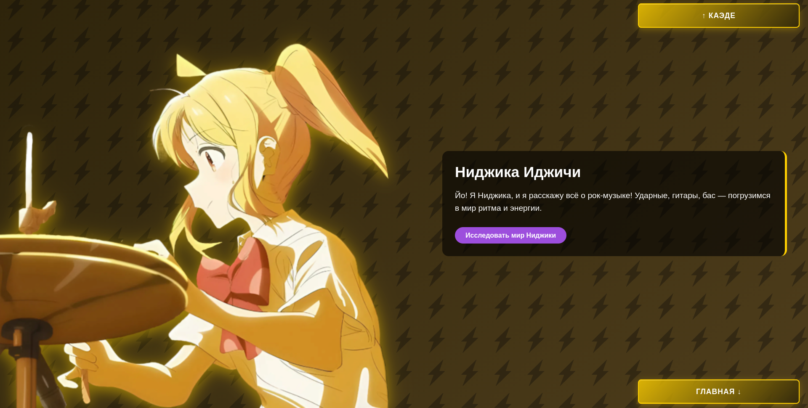
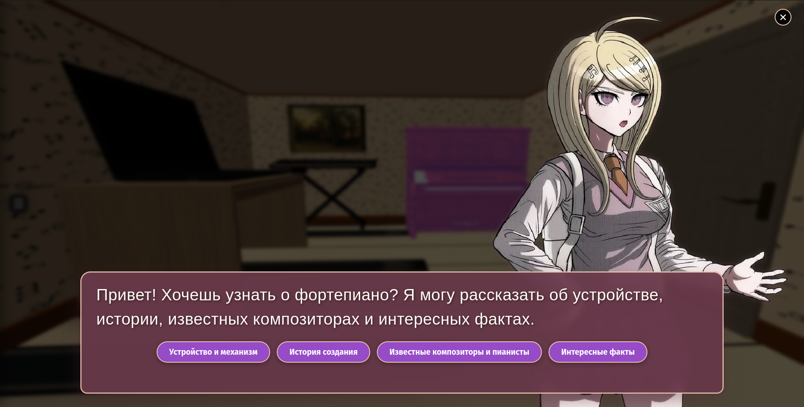
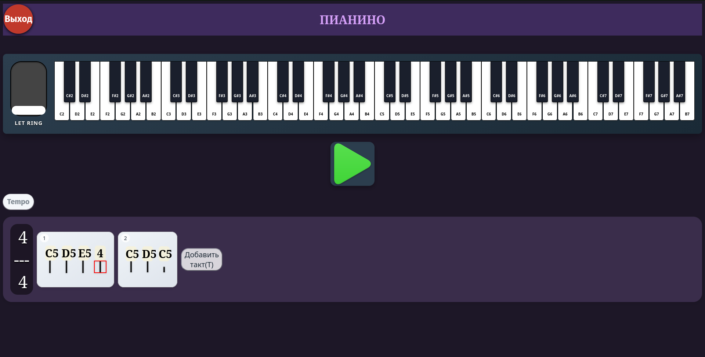
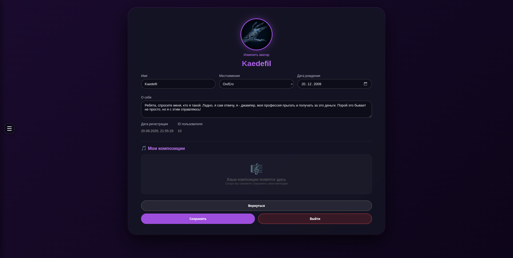

# Мир музыкальных инструментов

Интерактивный веб-сайт для изучения музыкальных инструментов и создания мелодий в формате 3D-экскурсии.
Проект выполнен в жанре «виртуальной экскурсии» по комнатам двух персонажей — **Каэде** (клавишные и теория) и **Ниджики** (рок-музыка и ритм).
С полноценной системой аутентификации, профилями пользователей и обратной связью.

Погрузись в атмосферу музыки, исследуй 3D-сцены, взаимодействуй с объектами, читай диалоги и сочиняй свои произведения во встроенном нотном редакторе.

## Демо

Продакшн: [https://nijede.gapkala.ru](https://nijede.gapkala.ru)

Бэкенд развёрнут на собственном сервере (PHP 8.5 + MariaDB), фронтенд раздаётся тем же доменом.

## Скриншоты

| Главный экран | Комната Каэде |
|:-------------:|:-------------:|
|  |  |
| **Нотный редактор** | **Авторизация** |
|  |  |

## Возможности

- **Две 3D-комнаты** с уникальными интерьерами и персонажами (Каэде и Ниджика).
- **Интерактивные объекты** — клик по предмету открывает контекстное меню (диалог, переход к инструменту, выход).
- **Система диалогов (новелла)** — ветвление, выборы, спрайты, аудио-вставки и изображения, эффект «печатной машинки».
- **Встроенный нотный редактор** для каждого инструмента:
  - добавление/удаление нот
  - изменение длительности (разделение/слияние)
  - лиги
  - настройка темпа и размера такта
  - репризы с указанием количества повторений
  - воспроизведение партии через Web Audio API
- **Поддержка инструментов**: пианино, синтезатор, электрогитара, акустическая гитара, бас-гитара, ударная установка, флейта, скрипка.
- **Аудиосопровождение** — фоновая музыка в каждой комнате, звуки инструментов, демо-вставки в диалогах.
- **Аутентификация** — регистрация, вход, выход, PHP-сессия, хеширование паролей `password_hash`.
- **Профиль пользователя** — имя, аватар (загрузка и обработка через GD: 300×300, WebP), местоимения, дата рождения, био, дата регистрации, ID.
- **Обратная связь** — модальное окно с типами (общее / ошибка / предложение), запись в БД.
- **Поиск** по инструментам с группировкой по категориям.
- **Адаптивный интерфейс** с боковым меню и подсказкой поворота экрана на мобильных.

## Установка и запуск

Проект состоит из **фронтенда (статика)** и **бэкенда (PHP 8 + MySQL/MariaDB)**. Оба лежат в одном репозитории.

### 1. Клонирование

```bash
git clone https://github.com/KaedeCode/Nijede.git
cd Nijede
```

### 2. Бэкенд

Зависимостей нет — нужны только PHP с расширениями `pdo_mysql`, `gd`, `mbstring` и MySQL/MariaDB.

```bash
mysql -u root -p -e "CREATE DATABASE nijede CHARACTER SET utf8mb4 COLLATE utf8mb4_unicode_ci"
mysql -u root -p nijede < backend/migrations/001_init.sql
cp backend/.env.example backend/.env
```

В `backend/.env`:

```env
APP_ENV=dev
FRONTEND_URL=http://localhost:5500
DB_HOST=localhost
DB_PORT=3306
DB_NAME=nijede
DB_USER=your_user
DB_PASSWORD=your_password
```

Запуск:

```bash
php -S 127.0.0.1:3000 -t backend/public backend/public/index.php
```

Сервер поднимется на `http://localhost:3000`. Загруженные аватары будут лежать в `backend/storage/avatars`.

### 3. Фронтенд

Из корня репозитория (там, где `index.html`):

```bash
python -m http.server 5500
# или через Live Server в VS Code
```

Открываем `http://localhost:5500`.

`API_BASE` в `js/core/config.js` определяется автоматически: на `localhost` — `http://localhost:3000/api`, иначе — `/api` (same-origin).

### 4. Продакшн-деплой

- Фронт и бэк живут на одном домене (`https://nijede.gapkala.ru`).
- nginx раздаёт статику из корня репозитория, `/api/*` уходит в PHP-FPM (`backend/public/index.php`), `/uploads/` — из `backend/storage`.
- В `.env` ставим `APP_ENV=production`. Сессионная кука автоматически станет `secure`.
- Схема применяется один раз: `mysql nijede < backend/migrations/001_init.sql`.

## Управление

### Главная страница и комнаты

- **Навигация между секциями** — клавиши **↑ / ↓** или **W / S**, либо кнопки интерфейса.
- **Боковое меню** — кнопка «☰» слева.
- **Камера в 3D-комнатах** — движение мыши (курсор плавно поворачивает обзор).
- **Взаимодействие с объектом** — клик по подсвеченному предмету → контекстное меню с действиями.

### Нотный редактор (мелодические инструменты)

| Клавиша | Действие |
|---------|----------|
| **S**   | Разделить выбранную ноту (уменьшить длительность вдвое) |
| **W**   | Соединить две соседние ноты одинаковой длительности |
| **A**   | Пометить ноту красным (будет подсвечена при воспроизведении) |
| **D**   | Снять пометку |
| **T**   | Добавить такт |
| **E**   | Дублировать текущий такт |
| **R**   | Удалить текущий такт |
| **→ / ←** | Сдвинуть такт вправо/влево |
| клик по такту | Открыть меню действий с тактом |

### Ударные

Управление то же, но добавление нот — через всплывающую подсказку с выбором инструмента (клавиши `0–9`, `-`, `=`):

| Клавиша | Инструмент |
|---------|-----------|
| 0 | бас-бочка |
| 1 | крэш |
| 2 | райд |
| 3 | малый барабан |
| 4 | закрытый хай-хэт |
| 5 | открытый хай-хэт |
| 6 | педаль хай-хэта |
| 7 | напольный том |
| 8 | средний том |
| 9 | высокий том |
| - | стик |
| = | белл райда |

## Архитектура проекта

Фронтенд — чистый ES6-модуль + Three.js r128 + Web Audio API. Бэкенд — PHP без зависимостей, PDO + MySQL, PHP-сессии.

### Фронтенд

**`js/core/`** — базовый слой без привязки к конкретной странице.

| Файл | Назначение |
|------|-----------|
| `config.js` | `API_BASE`, `SECTIONS`, `PROJECT_ROOT`, `INSTRUMENTS`, `SEARCH_DATA`. |
| `api.js` | Обёртка над `fetch` с `credentials: 'include'` и авто-заголовками. |
| `dom.js` | Хелперы: `escapeHtml`, `$`, `$$`. |
| `resource-loader.js` | Предзагрузка изображений и аудио через `Promise.allSettled`. |

**`js/features/`** — функциональные модули, переиспользуемые на страницах.

| Файл | Назначение |
|------|-----------|
| `auth/auth.js` | Регистрация/вход/выход, `localStorage`-сессия, рендер UI профиля в шапке и сайдбаре, `getAuth()`-синглтон. |
| `novel/novel.js` | Движок новеллы: очередь реплик, спрайты, выборы, аудио-вставки, typewriter, `getNovel()`-синглтон. |
| `novel/dialogs.js` | Дерево диалогов для всех интерактивных объектов (`DIALOGS_MAP`). |
| `scene/kaede.js` | 3D-сцена комнаты Каэде: загрузка OBJ/MTL, свет, тени, hover, контекстное меню. |
| `scene/nijika.js` | То же для комнаты Ниджики + карта `MODEL_SLUG_MAP` для `guiter → guitar`. |
| `menu.js` | Боковое меню: открытие/закрытие, инжект блока авторизации. |
| `music.js` | Управление фоновым аудио и громкостью через `[data-music-toggle]` и `[data-volume]`. |
| `search.js` | Поиск по `SEARCH_DATA` с группировкой по категориям. |
| `nav.js` | Навигация по секциям главной страницы (стрелки, W/S). |
| `popup.js` | Модалка «О проекте» через SweetAlert2. |
| `feedback.js` | Модалка обратной связи + POST `/api/feedback`. |
| `actions.js` | Единый биндер `[data-action="show-popup"]` и `[data-action="show-feedback"]`. |
| `rotate.js` | Оверлей «поверни телефон» для портретной ориентации. |

**`js/instruments/`** — редакторы.

| Файл | Назначение |
|------|-----------|
| `melodic.js` | Мелодический редактор: клавиатура, такты, ноты, лиги, репризы, воспроизведение. |
| `drums.js` | Редактор ударных: нотоносец с 8 рядами, выбор инструмента по клавишам. |

**`js/pages/`** — тонкие точки входа, инициализируют нужные фичи под конкретную страницу.

| Файл | Страница |
|------|----------|
| `landing.js` | `index.html` |
| `kaede-page.js` | `pages/kaede.html` |
| `nijika-page.js` | `pages/nijika.html` |
| `profile-page.js` | `pages/profile.html` |
| `instrument-page.js` | `pages/instrument.html` — диспатчер по `?slug=`, определяет мелодический/ударный редактор, тему и preloader. |

### Бэкенд (`backend/`)

| Файл | Назначение |
|------|-----------|
| `config.php` | `.env`, автозагрузчик `App\`, PDO-подключение. |
| `public/index.php` | Маршруты `/api/*`, сессия, CORS в dev. |
| `src/Router.php` | Минимальный роутер с обработкой ошибок. |
| `src/Json.php` | JSON-ответы и чтение тела запроса. |
| `src/Auth.php`, `src/Validator.php` | Проверка сессии и валидация полей. |
| `src/Controllers/` | `AuthController`, `ProfileController`, `FeedbackController`, `CalendarController`. |
| `src/Models/` | `User`, `Feedback` — запросы через PDO. |
| `migrations/001_init.sql` | Схема `users` и `feedback`. |
| `storage/avatars/` | Загруженные аватары (gitignore). |

### Взаимодействие модулей

- **3D → диалоги.** Клик по объекту → `handleObjectInteraction` → `getNovel().show(DIALOGS_MAP[objectName][action])`.
- **3D → редактор.** «Поиграть» → `instrument.html?slug=<name>`, где `slug` совпадает с ключом в `INSTRUMENTS`.
- **Редактор → звук.** `melodic.js` использует один сэмпл `C4_<instrument>.flac` и меняет `playbackRate` для транспонирования; `drums.js` играет готовые FLAC-сэмплы.
- **Auth.** `auth.js` общается с `/api/*` через `fetch` с `credentials: 'include'`, состояние хранит в `localStorage` (`auth_current_user`) и валидирует через `GET /api/profile`.
- **Обратная связь.** `feedback.js` → `POST /api/feedback` с `credentials: 'include'` (если юзер залогинен, `user_id` проставится автоматически).

## Структура проекта

```
.
├── assets/
│   ├── audio/
│   │   ├── instruments/          # C4_*.flac + drums/*.flac
│   │   ├── kaede_room/           # демо-звуки из диалогов Каэде
│   │   ├── music/                # фоновая музыка комнат
│   │   └── nijika_room/          # треки из диалогов Ниджики
│   ├── images/
│   │   ├── instruments/          # play/stop, barOfStaff, drums.png, notes/, stems/
│   │   ├── kaede_room/           # иллюстрации для диалогов
│   │   ├── sprites/
│   │   │   ├── kaede/            # спрайты Каэде (.webp)
│   │   │   └── nijika/           # спрайты Ниджики (.webp)
│   │   ├── kaede.png
│   │   ├── nijika.png
│   │   ├── logo.png
│   │   ├── note_bg.png
│   │   └── lightning_bg.png
│   └── models/
│       ├── kaede/                # .obj/.mtl + textures
│       └── nijika/               # .obj/.mtl + textures
├── backend/
│   ├── config.php
│   ├── .env.example
│   ├── public/index.php
│   ├── src/
│   │   ├── Controllers/
│   │   ├── Models/
│   │   ├── Auth.php
│   │   ├── Json.php
│   │   ├── Router.php
│   │   └── Validator.php
│   ├── migrations/001_init.sql
│   └── storage/avatars/         # загруженные аватары (gitignore)
├── css/
│   ├── base.css                  # reset, общие стили, главная, контекстное меню, auth-модалки
│   ├── components/
│   │   ├── novel.css
│   │   └── sidebar.css
│   ├── pages/
│   │   ├── instrument-drums.css
│   │   ├── instrument-kaede.css
│   │   ├── instrument-nijika.css
│   │   └── profile.css
│   └── themes/                   # зарезервировано под темы
├── js/
│   ├── core/
│   │   ├── api.js
│   │   ├── config.js
│   │   ├── dom.js
│   │   └── resource-loader.js
│   ├── features/
│   │   ├── actions.js
│   │   ├── auth/auth.js
│   │   ├── feedback.js
│   │   ├── menu.js
│   │   ├── music.js
│   │   ├── nav.js
│   │   ├── novel/
│   │   │   ├── dialogs.js
│   │   │   └── novel.js
│   │   ├── popup.js
│   │   ├── rotate.js
│   │   ├── scene/
│   │   │   ├── kaede.js
│   │   │   └── nijika.js
│   │   └── search.js
│   ├── instruments/
│   │   ├── drums.js
│   │   └── melodic.js
│   └── pages/
│       ├── instrument-page.js
│       ├── kaede-page.js
│       ├── landing.js
│       ├── nijika-page.js
│       └── profile-page.js
├── pages/
│   ├── instrument.html
│   ├── kaede.html
│   ├── nijika.html
│   └── profile.html
├── screenshots/
├── index.html
├── LICENSE
└── README.md
```

## Технологии

### Фронтенд

- **HTML5 / CSS3** — тёмная тема, анимации, glassmorphism.
- **Vanilla JS (ES6-модули)** — без сборщиков и фреймворков.
- **Three.js r128** + `OBJLoader`, `MTLLoader` — 3D-сцены, тени (PCFSoft), raycast.
- **Web Audio API** — воспроизведение нот, транспонирование через `playbackRate`.
- **SweetAlert2** — модалки (инфо, обратная связь, подтверждения).

### Бэкенд

- **PHP 8.5** — без зависимостей и сборщиков
- **MySQL** / **MariaDB** + **PDO** — данные и схема
- **PHP-сессии** — авторизация
- **`password_hash` / `password_verify`** — пароли (bcrypt)
- **GD** — ресайз 300×300 и конвертация аватаров в WebP

## Системные требования

- **Браузер**: Chrome / Firefox / Edge / Safari последних версий с поддержкой ES-модулей, WebGL и Web Audio API.
- **PHP**: ≥ 8.5 с расширениями `pdo_mysql`, `gd`, `mbstring`, `fileinfo`.
- **MySQL**: 8.x (или MariaDB 10.6+).
- **ОЗУ**: от 2 ГБ для комфортной работы 3D.
- **Интернет**: нужен для загрузки моделей, аудио и CDN-библиотек.

## Известные особенности

- **Модели грузятся целиком в первый заход.** При медленном канале первая загрузка комнаты может занять 10–20 секунд — показывается спиннер с подсказкой.
- **Аудио — FLAC/Opus.** FLAC используется для коротких сэмплов нот (высокое качество важно для `playbackRate`), Opus — для музыки и речи.
- **Спрайты — WebP.** Поддерживаются всеми актуальными браузерами.
- **ES-модули требуют HTTP.** Страницы не откроются через `file://` — нужен любой локальный сервер (`python -m http.server`, `live-server` и т.п.).

## Атрибуция и лицензии материалов

### Библиотеки
- [Three.js](https://github.com/mrdoob/three.js) — MIT
- [SweetAlert2](https://github.com/sweetalert2/sweetalert2) — MIT

### 3D-модели
Трёхмерные модели (комнаты, мебель, инструменты) загружены с **Sketchfab** в рамках бесплатных общедоступных моделей. К сожалению, информация об авторах не сохранилась. Если вы автор модели, использованной в проекте, — свяжитесь с нами, мы добавим ваше имя или удалим модель.

### Изображения и спрайты
- **Спрайты Каэде Акамацу** — из игры *Danganronpa V3: Killing Harmony* (© Spike Chunsoft). Fan-project, некоммерческое использование.
- **Спрайты Ниджики Иджичи** — обработанные кадры из аниме *Bocchi the Rock!* (© Aki Hamaji / Houbunsha, CloverWorks). Fan-project, некоммерческое использование.
- **Фоновые текстуры** — открытые источники, авторство большей части неизвестно.
- Остальные иконки и элементы UI сделаны авторами проекта.

**Если вы правообладатель и считаете использование неправомерным** — напишите нам, удалим или укажем корректное авторство.

### Аудио

| Файл | Композиция | Автор |
|------|-----------|-------|
| `main_theme.opus` | Главная тема (DDLC) | Dan Salvato |
| `moonlight_sonata.opus` | «Лунная соната», op. 27 № 2 | Ludwig van Beethoven |
| `to_live_is_to_die.opus` | «To Live Is to Die» | Metallica |
| `givenUp.opus`, `inTheEnd.opus` | — | Linkin Park |
| `kBand.opus` | «That Band» (Bocchi the Rock!) | 草野華余子, аранж. 三井律郎 |

Остальные аудиофайлы — демонстрационные примеры звукового дизайна, созданные авторами или взятые из свободных библиотек.

## Авторы

- **Александр Фролякин** — 3D-сцены, novel-движок, комната Каэде, auth + feedback + profile, интеграция бэкенда, рефакторинг структуры.
  [GitHub](https://github.com/KaedeCode) · [Telegram](https://t.me/KaedeCode)
- **Кирилл Житников** — нотный редактор, аудиосистема, комната Ниджики.
  [GitHub](https://github.com/arkin99-p)

## Лицензия

Проект распространяется под лицензией [MIT](LICENSE).
3D-модели и звуки взяты из открытых источников — если вы автор какого-либо материала, свяжитесь с нами для указания авторства или удаления.